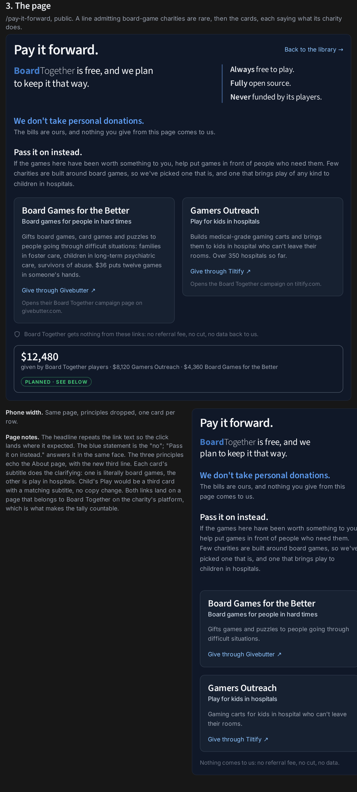

# Pay it forward

Board Together asks players who enjoy the site to give to charities that put games in front of people, never to the site itself. The first call to action must be quiet and must read as "not for us" at a glance. A page explains the rest once a player engages.

Mockups: [`pay-it-forward/mockups.html`](pay-it-forward/mockups.html) (open in a browser). The settled page is rendered in [`pay-it-forward/page.png`](pay-it-forward/page.png).

## Settled with the user

- The label everywhere is **Pay it forward**. "Donate" and "Support us" never appear on our own pages; both read as asking for ourselves.
- The "no" is **We don't take personal donations.** The word *personal* matters: corporate sponsorship of the site stays possible, players never pay. It is followed by **The bills are ours, and nothing you give from this page comes to us.**
- The charities are **Gamers Outreach** (US; gaming carts for kids in hospitals) and **SpecialEffect** (UK; adapted controls so people with physical disabilities can play). Gamers Outreach was chosen over Extra Life. Board Games for the Better was the first board-game pick but could not be reached. Players are worldwide, so one US and one UK charity is a feature, and each card says which country it is in.
- The page admits the choice plainly: few board game charities work at scale and meet our bar, so these two were picked. It also tells players to give to their favorite charity instead if these two aren't for them.
- A running **tally** of what Board Together players have raised is wanted. An "I gave" self-report button is not.
- No modals, banners or coloured buttons for the ask. No eyebrow labels in the page typography.
- The finished-game line ("Good game? Pass it on.") is a maybe. The milestone card is parked for a later revisit. Neither is in the first version.

## The page: /pay-it-forward

Public, in the About page's visual language.

1. Title **Pay it forward.** with a link back to the library.
2. Header row: the lead "**Board**Together is free, and we plan to keep it that way." with the wordmark (bold blue Board, light Together), and the principles column shared with About: *Always* free to play. *Fully* open source. (A third, *Never* funded by its players, was dropped as a restatement of "free".)
3. Full width below the header:
   - **We don't take personal donations.** as a blue statement, with its one body line.
   - **Pass it on instead.** as a white statement in the same face, with "If the games here have been worth something to you, help put games in front of people who need them. Few board game charities work at scale and meet the bar we set, so we picked these two. They bring play to people who can't easily get to it: kids stuck in hospital rooms, and players who need adapted controls." On phones the paragraph stops after "these two."
4. One card per charity: name with an outlined country tag ("US charity", "UK charity"), a brighter subtitle saying what it does, a short description, a "Give through …" link to a Board Together page on the charity's platform, and a line saying where it opens.
5. "If these two aren't for you, give to your favorite charity instead. It's paying it forward all the same."
6. "Board Together gets nothing from these links: no referral fee, no cut, no data back to us."
7. The tally: total raised by Board Together players, with the split per charity.

On phones the principles column drops and the cards stack.

## Entry points

All are links to the page, at the visual weight of "About Us".

- Header text link with a heart icon. Its tooltip says "Help charities put games on more tables. Nothing goes to us."
- Phone account menu entry beside "About us".
- About page: a third card, "Pay it forward", whose first sentence is "We don't take personal donations."
- Landing small print: "*Always* free to play. Fully open source. No tip jar, but you can pay it forward →".
- One-line footer at the end of the signed-in library's game list (the library and dashboard fit the viewport and scroll inside, so a page footer would always be on screen): "Free to play, always. Board Together takes no personal donations. Pay it forward →".

## The tally

`GET /api/v1/pay-it-forward/tally` is public. `CharityTallyService` (libs/backend-services/src/payItForward) reads both Board Together team campaigns from Tiltify's v5 public API (`/api/public/team_campaigns/{id}`), converts pounds to dollars at the day's ECB rate from api.frankfurter.dev (keyless), and caches the result in Redis for an hour. The route lets browsers cache it for ten minutes. The page asks once on load; the browser never polls.

| Charity | Campaign | Currency |
|---|---|---|
| Gamers Outreach | tiltify.com/+boardtogether-community/fundraiser-for-gamers-outreach-foundation (team campaign `1aa404bd-38e9-4955-9178-4f52b63085ac`) | USD |
| SpecialEffect | tiltify.com/+boardtogether-community/fundraiser-for-specialeffect (team campaign `4f5b25b7-1a1a-4e50-a65b-c0831eeca686`) | GBP |

- Totals are `total_amount_raised`, which includes campaigns that support ours. The page says "raised", not "received", because platform totals can include unsettled gifts.
- The headline is the dollar total; the detail line shows each charity in its own currency: "$1,260 raised by Board Together players · $820 for Gamers Outreach · £330 for SpecialEffect". Amounts are truncated to whole units.
- The tally is hidden while nothing has been raised, and when the API is unavailable.
- The campaigns belong to the BoardTogether Community team, so players can start their own campaigns in support of them; `total_amount_raised` counts those too. The first campaigns, under the personal @boardtogether account, were removed.
- Tiltify retires a campaign after six months without a donation. A retired or unpublished campaign's card links to the charity's own donation page instead (gamersoutreach.org/donate, specialeffect.org.uk/donate).
- Tiltify answers in HTML unless the request sends `Accept: application/json`.

Credentials: a Tiltify application owned by the BoardTogether Tiltify account, client credentials flow, `public` scope, two-hour tokens refreshed a minute early. The client ID and secret are the Secret Manager secrets `TILTIFY_CLIENT_ID` and `TILTIFY_CLIENT_SECRET`; `backend` and `tabletop-investigate` can read them. The backend only builds the service when `TILTIFY_CLIENT_ID` is set, so local development without them gets a 404 and no tally.

To ship: attach both secrets to the `backend` Cloud Run service as environment variables of the same names, then release the backend before the frontend.

## First version

| Piece | Status |
|---|---|
| /pay-it-forward page | Built; cards link to the Board Together team campaigns on Tiltify |
| Header link and phone menu entry | Built |
| About card | Built (the principles list is shared with this page) |
| Landing small print | Built |
| Signed-in footer line | Built, at the end of the library's game list |
| Tally | Built: dollar headline, each charity in its own currency, hourly backend cache |
| Finished-game line | Maybe, not in v1 |
| Milestone card | Revisit later |
| "I gave" button | Dropped |

## Other charities considered

Board-game-specific charities are rare and mostly small. Checked on 2026-10-21 and 2026-10-26:

- **Extra Life** (Children's Miracle Network Hospitals, DonorDrive): keyless public API. Dropped in favour of Gamers Outreach.
- **Board Games for the Better** (New York, board games for people in hard times, Givebutter): the first pick, dropped because they could not be reached.
- **AbleGamers** (US, accessibility, Tiltify): rejected after the May 2025 IGN report of former employees' allegations of abuse and financial mismanagement against founder Mark Barlet, which he denies.
- **Child's Play** (games for children's hospitals): no API of its own; fundraisers run on Tiltify (tiltify.com/child-s-play). Clean record, but overlaps Gamers Outreach.
- **Take This** (mental health in the games industry, Tiltify or Streamlabs): furthest from the pitch.
- **Jack Vasel Memorial Fund** (hardship grants to gamers, EIN 45-1583593): PayPal button only, no totals.
- **Meeples for Peeples** (St. Louis, games for families and educators): Give Lively, which has no public API, only an iframe widget and member-side Zapier.
- **Board Game Buddies** (Chicago), **Board Game Blast** (Los Angeles), **The Bodhana Group** (York, PA): small, no machine-readable totals found.
- **Game to Grow** is winding down; excluded.
